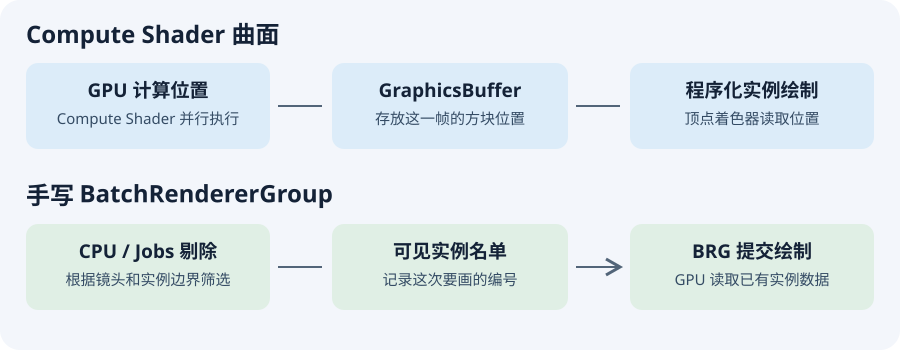

我跟着 Catlike Coding 的 Unity Basics 做了一个由立方体组成的动态曲面。做到 Compute Shaders 这一章时，我开始想，之前听说的 BRG 也能画大量方块，两者到底差在哪？后来拿一个会旋转、还会被炮弹打掉几块的体素模型来想，区别就清楚多了。 [Catlike Coding · Compute Shaders](https://catlikecoding.com/unity/tutorials/basics/compute-shaders/)

封面是我在 Unity 6.6 的 URP 编辑器里跑出的 **1000 × 1000** 环面。截图里的 FPS 是当时计数器的读数。后面表格里的对照实验固定用了 **100 × 100** 的 Wave 曲面。

## 先分清计算、存储和提交

| 名称 | 在做什么 | 方块例子 |
| --- | --- | --- |
| Compute Shader | 在 GPU 上执行并行计算 | 根据时间和公式生成方块位置，也能生成可见实例列表 |
| GraphicsBuffer | 保存 GPU 可访问的数据 | 存每个方块的位置、颜色或其他实例属性 |
| BatchRendererGroup（BRG） | 把实例组织成绘制批次，给 Unity 提供绘制命令 | 指定哪些方块可见、它们用哪个网格和材质 |
| RenderMeshPrimitives | 按调用者提供的数量提交程序化实例绘制 | 用一个 Cube 网格画完整张曲面 |



曲面这条路径是 **CPU 传少量参数并发起 Dispatch → GPU 算位置并写入缓冲区 → 绘制阶段直接读取缓冲区**。程序化提交让每个方块可以省掉独立的 GameObject、Transform 和 MeshRenderer。Compute Shader 进一步省下了 CPU 逐点计算和每帧上传逐点位置的开销。顶点变换、光照和阴影仍由 GPU 上相应的渲染阶段执行。 [Unity Compute Shader 入门](https://docs.unity.com/en-us/engine/6000.6/manual/materials-and-shaders/shaders/writing-custom/class-compute-shader/introduction) · [RenderMeshPrimitives](https://docs.unity.com/en-us/engine/6000.0/script-reference/unityengine/graphics/rendermeshprimitives)

手写 BRG 的常见流程是：注册网格和材质，把实例属性放进 GraphicsBuffer，通过 `AddBatch` 提供属性的读取布局，再在 `OnPerformCulling` 里输出可见编号和绘制命令。实例数据可以留在 GPU 上反复使用。CPU 或 Jobs 可以生成可见名单，Compute Shader 也可以负责更新实例数据，前提是数据布局和着色器匹配。 [Unity 的 BRG 绘制示例](https://docs.unity.com/en-us/engine/6000.6/manual/analysis/graphics-performance-profiling/in-urp/reduce-draw-calls-urp/batch-renderer-group/creating-a-renderer/draw-commands) · [URP 的 DOTS Instancing](https://docs.unity.com/en-us/engine/6000.6/manual/analysis/graphics-performance-profiling/in-urp/reduce-draw-calls-urp/batch-renderer-group/writing-shaders/dots-instancing-shaders)

## 同一张曲面的 URP 实测

| 实现 | 平均帧时 | 平均 FPS | 每帧 Draw Calls |
| --- | ---: | ---: | ---: |
| CPU 更新 GameObject，开启 GPU Instancing | 18.62 ms | 53.7 | 66 |
| Compute Shader + 程序化实例绘制 | 4.32 ms | 231.6 | 4 |

环境是 Unity **6000.6.10f1** 编辑器、Ryzen 9 7945HX 和 RTX 4060 Laptop GPU。两组都用 **10,000 个方块、同一个 Wave、1280 × 720、开启阴影、关闭 VSync**，各采 360 帧。平均帧时下降约 **77%**。这个数字是移除逐对象更新、把位置计算搬到 GPU、改变绘制提交方式之后的**整体收益**。BRG 没有参加这次对照，数据也无法单独拆出 Compute Shader 本身节省了多少时间。

## 体素模型一直转，为什么还适合 BRG？

假设一座雕像由 **5,000 个体素方块**拼成，整座雕像在移动和旋转。头盔上的一个方块原来位于模型中心右侧两格，雕像转过来后，它在雕像内部依旧是右侧两格。变的是雕像与世界的关系。

1. **初始化**时，把各体素在模型空间的位置和颜色上传到 GPU。
2. **每帧**只更新整座雕像的局部到世界矩阵。每座雕像一份。
3. **绘制**时，顶点着色器以方块的局部位置为偏移，再乘雕像的矩阵。
4. **击中方块**时，更新格子的存活状态或绘制名单。整座模型的刚体运动与单个格子的损坏可以分别处理。

如果原方案每帧重传 5,000 个 4 × 4 浮点矩阵，矩阵数据量是 **320,000 字节／帧**。共享之后，一份相同格式的父级矩阵是 **64 字节／帧**。这是矩阵字段的理论对比；实际传输量还要看矩阵打包、可见列表、额外属性和破坏更新。GPU 仍需要读取局部数据并变换顶点。URP 的 BRG 实例数据格式可以自定义，也支持多个实例读取同一个属性值。 [URP 的 DOTS Instancing](https://docs.unity.com/en-us/engine/6000.6/manual/analysis/graphics-performance-profiling/in-urp/reduce-draw-calls-urp/batch-renderer-group/writing-shaders/dots-instancing-shaders)

这里有一个实现前提。普通材质按默认方式读取的 `unity_ObjectToWorld` 是每个实例的世界矩阵。如果仍用这种布局，雕像一转，所有世界矩阵都会变。要只更新一份，就要让 Shader 分开读取**方块的局部偏移**和**雕像共享的矩阵**。

## URP Shader 示例：共享父级矩阵

下面是给 `Graphics.RenderMeshPrimitives` 用的最小 **URP Unlit** 顶点和片元代码片段。它假设小方块共用尺寸与方向，并用 `SV_InstanceID` 读取模型空间偏移。把函数放进 URP ShaderLab 的 Pass 里，配置 `#pragma vertex Vert`、`#pragma fragment Frag` 和 `#pragma target 4.5`。C# 通过 `RenderParams.matProps` 绑定缓冲区和矩阵，并提供覆盖旋转后模型的世界空间包围盒。 [Unity RenderMeshPrimitives 示例](https://docs.unity.com/en-us/engine/6000.0/script-reference/unityengine/graphics/rendermeshprimitives)

```hlsl
#include "Packages/com.unity.render-pipelines.universal/ShaderLibrary/Core.hlsl"

StructuredBuffer<float4> _VoxelLocalOffsets; // xyz 是局部偏移，w 保留
float4x4 _ModelToWorld;
float _VoxelSize;

struct Attributes
{
    float3 positionOS : POSITION;
    uint instanceID : SV_InstanceID;
};

struct Varyings
{
    float4 positionCS : SV_POSITION;
};

Varyings Vert(Attributes input)
{
    Varyings output;
    float3 offset = _VoxelLocalOffsets[input.instanceID].xyz;
    float3 positionMS = input.positionOS * _VoxelSize + offset;
    float3 positionWS = mul(_ModelToWorld, float4(positionMS, 1.0)).xyz;
    output.positionCS = TransformWorldToHClip(positionWS);
    return output;
}

half4 Frag(Varyings input) : SV_Target
{
    return half4(0.30, 0.68, 0.85, 1.0);
}
```

**接入 BRG 时沿用同一套坐标公式**。在自定义 DOTS Instancing Shader 中，用 DOTS 实例属性读取每块的局部偏移，用共享属性读取父级矩阵。BRG 的可见编号可能不连续，实例数据的寻址要走 DOTS Instancing 的访问方式。上面直接用 `SV_InstanceID` 下标的片段适用于这里的连续实例演示。正式的 Lit 材质还要正确变换法线，并在阴影、深度等所需 Pass 中使用一致的位置计算。 [Unity DOTS Instancing 属性说明](https://docs.unity.com/en-us/engine/6000.3/manual/analysis/graphics-performance-profiling/in-urp/reduce-draw-calls-urp/batch-renderer-group/writing-shaders/dots-instancing-shaders-declare)

## 回到游戏里怎么选

- **整体移动或旋转**：先共享父级矩阵，局部数据尽量留在 GPU。BRG 可以负责批量提交，顶点着色器完成变换。
- **只有少量方块被打掉**：可以在 CPU 上用网格记录存活状态，把命中点转换到模型空间，找到对应格子。渲染侧只更新受影响的实例数据或可见列表。
- **大量方块独立变形或飞散**：如果位置主要服务于画面，而且能并行计算，可以让 Compute Shader 生成位置。若可见名单和数量也在 GPU 上产生，可以交给间接绘制，省去 CPU 回读。 [Unity RenderMeshIndirect](https://docs.unity.com/en-us/engine/6000.6/script-reference/unityengine/graphics/rendermeshindirect)

我会先用 Profiler 看耗时究竟在 CPU 更新、剔除、提交，还是 GPU 画阴影和像素。对整座旋转的体素模型，**先把 5,000 份会变化的世界矩阵拆成一份共享矩阵和 5,000 份可复用的局部数据**，这个决定比先选 BRG 还是 Compute Shader 更直接。
