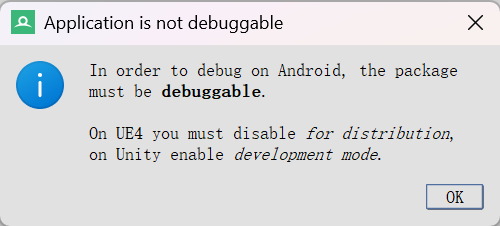
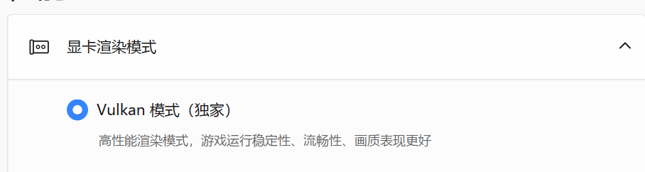
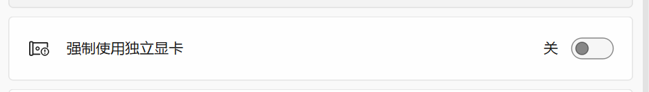
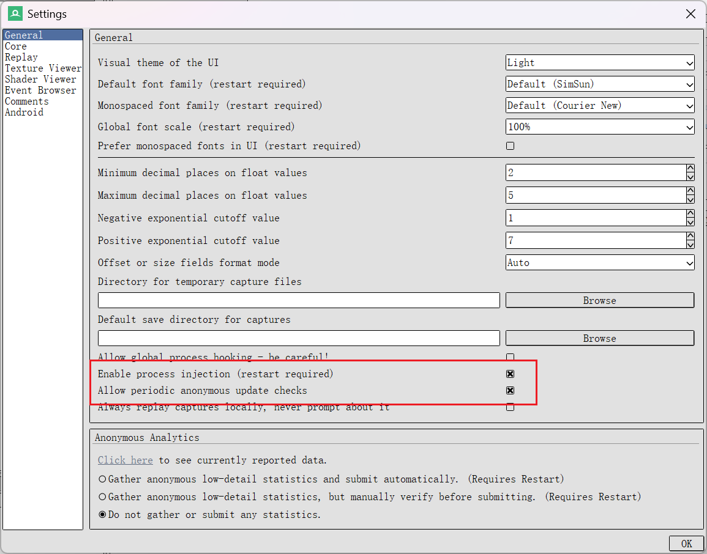
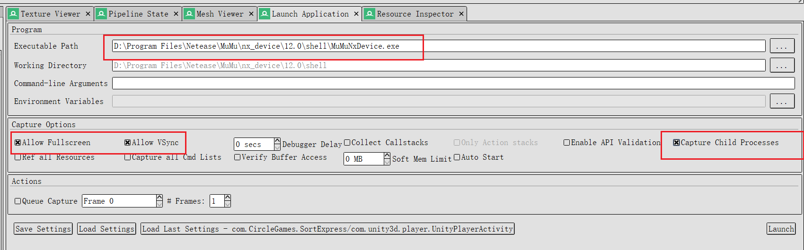

这篇笔记原先写在 FlowUs，记录了我用 RenderDoc 和 MuMu 模拟器做渲染截帧的一次实测。原文使用的是 **MuMu V5.9.0**，其他版本是否能按同样的步骤操作，我没有验证。

## 背景

我想通过截帧观察 Unity 应用的渲染流程，比如 Shader、相机设置和一帧里的绘制顺序。在安卓设备上直接用 RenderDoc 调试时，遇到了下面的报错。



报错提示安卓包需要是可调试的。对于自己构建的 Unity 包，可以按提示启用 **Development Build**。后来我看到有人用 **RenderDoc + MuMu 模拟器**分析一帧的渲染过程，便在当时的版本上试了一遍，把设置记了下来。请在自己的应用或有权调试的应用上使用这些步骤。 [原文参考](https://zhuanlan.zhihu.com/p/702990379)

## 安装并设置 MuMu 模拟器

我实测时使用的是 **V5.9.0**。安装后，在模拟器设置里把显卡渲染模式设为 **Vulkan 模式**。 [MuMu 模拟器下载](https://mumu.163.com/download/)



我当时也关闭了 **强制使用独立显卡**。



## 设置 RenderDoc

在 RenderDoc 里打开 **Tools → Settings**。下面是原始设置截图，**Enable process injection** 旁标有需要重启。红框里的匿名更新检查是截图里的另一项设置。



切到 **Launch Application**，把 **Executable Path** 指向 MuMu 安装目录下的可执行文件。当时的相对路径如下，具体安装目录以本机为准。

```text
nx_device\12.0\shell\MuMuNxDevice.exe
```

下图保留了我当时的 **Capture Options**，包括已勾选的 **Capture Child Processes**。



## 启动并截帧

点击 **Launch** 启动模拟器。在模拟器里运行要调试的应用，进入想分析的画面后按 **F12** 截帧。然后就可以在 RenderDoc 里顺着这一帧的绘制事件查看渲染流程。
